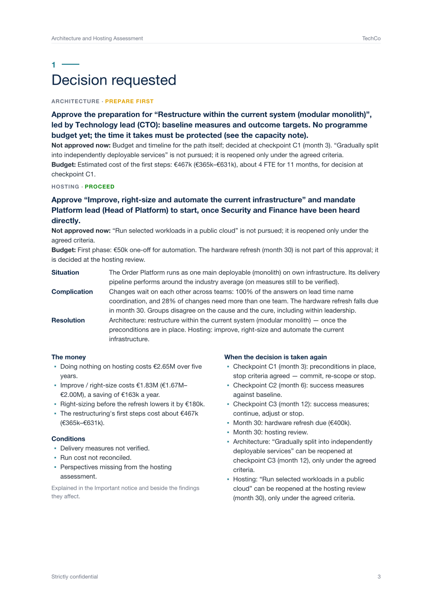
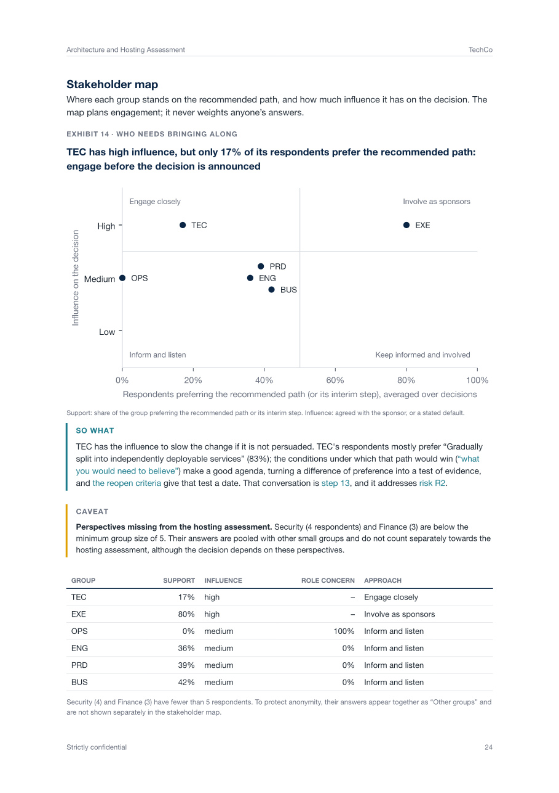

An evidence-based way to decide whether a software platform should change — and if so, how far — before anyone
commits budget, careers or a timeline to it.

## Why this exists

**Microservices are not a silver bullet.** A well-designed monolith can outperform a poorly executed distributed
system any day. The same is true for hosting: a team that could run its whole platform on one machine may pay several
times as much in the cloud — or may be held back by hardware it can no longer scale.

These decisions are rarely made on evidence alone. Platform leads want to modernise, teams want to keep what they have
built, executives want speed, finance wants predictability, and everyone's view is coloured by what the change would
mean for them. The result is months of debate, or a programme that starts for the wrong reasons.

This tool acts as a **neutral referee**. It combines hard facts about the system with a structured survey of every
stakeholder group, applies decision rules that were agreed **before** anyone saw the results, and produces one report
that says which path the evidence supports, how sure it is, what must be true before committing, and what that means
for the people involved. Sometimes the answer is "restructure". Sometimes it is "keep it and fix how you release".
Sometimes it is "move back from the cloud". All of them are valid outcomes.

## What you get

One report per assessment, ready for an executive audience:

<table>
<tr>
<td width="50%"></td>
<td width="50%"></td>
</tr>
<tr>
<td><em>Page one asks for a decision: what to approve now and who leads it, what is not approved yet, the money, the open conditions, and when the decision is taken again.</em></td>
<td><em>Every exhibit states its insight and its role in the argument; its “so what” links to the related findings, steps and risks, and caveats sit beside what they qualify.</em></td>
</tr>
</table>

- **A decision request on page one** — per decision, what to approve now and who leads it, what is explicitly not
  approved yet, the first-phase budget, the open conditions, and the checkpoints and dates at which it is decided again.
- **A recommended path for each decision**, with the probability that it holds:
  - *Architecture* — keep and improve delivery practices · restructure within the current system (modular monolith)
    · separate out one or two specific parts · gradually split into services · realign or consolidate existing services.
  - *Hosting* — keep as is · improve and right-size what you run · move selected workloads (hybrid) · move to the cloud
    · move back from the cloud.
  - *Build or buy* — for each part you name (billing, search, identity…): keep building it, or replace it with a
    product. Replacing applies only to parts that do not set the organisation apart, that a product covers well
    enough, and where buying is clearly cheaper — and it is linked to the architecture decision when the part's data
    must first be separated ([details](docs/build-or-buy.md)).
- **Why** — the evidence behind the verdict, and the single changes that would alter it
  ("splitting into services would apply if the need for change were at least 3.5; it is 3.3").
- **Every option considered** — side by side, with what you would need to believe for each alternative to win, so
  that a difference of opinion becomes a test of evidence.
- **What must happen first** — preconditions (sponsor, funding, capacity, baselines, stop criteria) with their status,
  and technical hard stops such as releases that cannot be rolled back.
- **The money** — five-year cost of every hosting option in euros with ranges, what doing nothing costs, worst / base
  / best scenarios with break-even values, a decision calendar (hardware refresh, contract end), the estimated
  investment for the recommended architecture path, and a budget by phase across both decisions.
- **Organisational readiness** — how each stakeholder group rates capabilities, ways of working and alignment, where
  groups disagree, the weakest areas, where lead time actually goes, and delivery performance against the industry
  benchmarks of DORA (Google Cloud's software-delivery research programme).
- **Stakeholder perspectives** — preferences, how each option would affect people's roles, and where perception and
  measurement differ; reported for groups only, framed as input for planning and communication.
- **Qualifications where the sources disagree** — the fact sheet, governance answers, survey and free text are read
  against each other; contradictions are printed beside the findings they affect, and serious ones keep the report a
  draft.
- **Risks, assumptions and dependencies**, a roadmap with checkpoints, success measures with baselines and targets,
  and criteria agreed now for when each decision is reopened.
- **Next steps** with named owners, drawn from an editable action library.
- Optionally, an **analysis of free-text answers** and a written **executive narrative** (see [AI-assisted analysis](#ai-assisted-analysis)).

## Who it is for

**Organisations assessing themselves.** A CTO, head of engineering or transformation office uses it to settle an
architecture or hosting question internally — ideally run by someone who is not the sponsor of the change
(see [If you are assessing your own organisation](#if-you-are-assessing-your-own-organisation)).

**Consultants and advisory firms.** Run it as a structured engagement for clients and deliver the report under your
own brand: your colours, fonts, logo and wording (see [Branding the report](#branding-the-report)).

## Try it in five minutes

```bash
git clone https://github.com/kayoslab/Migration-Readiness-Assessment.git
cd Migration-Readiness-Assessment
python -m venv .venv && source .venv/bin/activate      # Python 3.12 or later
pip install -e '.[dev]'

mra report examples/techco/engagement.yaml             # → Output/techco-report.pdf
```

`examples/techco` is a synthetic company — one monolith shared by eight teams, its own bare-metal hosting, a technology
lead who favours microservices and the cloud, and an operations team that favours keeping what it runs. The report
recommends preparing a restructuring within the system (about €470k once baselines are verified) and right-sizing
the current infrastructure rather than moving to the cloud, and qualifies both: the delivery measures are not yet
verified, the invoiced run cost is twice what the cost model accounts for, and too few Security and Finance
respondents took part to count separately. `mra decide examples/techco/engagement.yaml` prints the same verdict in the terminal.

Two more synthetic organisations show other situations (`python examples/build_<name>.py`, then `mra report`):
**MidCorp**, a messy case — the evidence does not decide the architecture, an unreconciled run cost puts hosting on
hold, and the report stays a draft; and **CloudCo**, a scale-up whose 40 services in the public cloud should be
consolidated and whose cloud setup should be optimised rather than left.

## How it decides

```
 Fact sheet (measured, weight 2) ─┐
                                  ├─► need · capability · operating-model fit · locality · cost
 Stakeholder survey (weight 1) ───┘                         │
                                     decision rules, agreed before results are seen
                                                            │
                     recommended path + probability · what would change it · hard stops
                                                            │
                  preconditions attested with evidence ─► proceed, or prepare first
```

- **Facts outweigh opinions.** Coupling, delivery and cost figures come from the fact sheet — coupling metrics are
  computed from git history — and count twice as much as survey perception. Where the two disagree, the disagreement
  is itself a finding.
- **Every group counts equally**, whatever its headcount, and groups with fewer than five respondents are never scored
  on their own.
- **Uncertainty is part of the answer.** Respondents are resampled and cost estimates sampled from their ranges two
  thousand times; a path is recommended only if it holds in at least 80% of these draws. Otherwise the report says
  the evidence is insufficient — and names the inputs that would settle it. "Insufficient evidence" is never a
  recommendation to keep the current state.
- **The rules are pre-registered.** Thresholds live in a YAML file that stakeholders sign off before results are
  seen. Any adjustment to the defaults is visible: the report shows what the unmodified rules would have said.
- **The sources are read against each other.** Delivery measures the governance checklist says were never measured,
  an invoiced run cost the cost model cannot account for, urgency in free text that the dates do not support, a
  view the survey contradicts — each is printed beside the finding it qualifies. If one could change the verdict,
  or the rules were not signed off in time, the report stays a draft.
- **Keeping what you have needs no preconditions; changing it does.** This favours reversible choices, and it is stated
  openly so that both sides of the debate sign it knowingly.
- **Personal stakes are measured, not judged.** Respondents state their preferred direction and how each option would
  affect their role. The report shows, at group level, where preferences track personal impact — never to discount
  anyone's view, only to plan for it.

The method has been tested on 1,770 simulated assessments with known correct outcomes: no wrong outcome away from a
threshold, and close to one, wrong outcomes only at the rate the agreed confidence level allows. See
[`docs/calibration.md`](docs/calibration.md).

## Running an assessment

```bash
mra init engagements/acme        # a folder with annotated templates and a checklist
```

1. **Scope.** In `engagement.yaml`, name the system and its current hosting, the sponsor of the change and the person
   who owns the fact sheet. These must be different people.
2. **Agree the rules.** Review `decision_rules.yaml` with the stakeholders and record who signed it off and when —
   before the fact sheet is frozen and before any results exist.
3. **Collect the facts.** Fill in `facts.yaml`. Coupling metrics come from the repository:
   ```bash
   mra coupling path/to/repo --modules modules.yaml      # or --codeowners CODEOWNERS
   ```
   For build or buy, name the candidate parts under `sourcing:` and fill in `sourcing.yaml` (people and running cost
   today; the product's licence, coverage of requirements, switching and exit cost; data export and compliance).
   Give cost inputs as low / likely / high estimates with their source grade, from two independent estimators —
   including the effort, external cost and duration of the first architecture steps. If you know how much comparable
   past programmes overran, record it: it raises the high end of the effort, cost and duration estimates. Record the date
   the sheet was frozen.
4. **Run the survey.** `mra forms engagements/acme/engagement.yaml --out forms.gs` writes a Google Apps Script that
   creates one form per stakeholder group (paste it into script.google.com and run `createForms`). Send the forms with
   the participant information in [`instrument/participant-information.md`](instrument/participant-information.md),
   from a sender who is not an advocate of either side, and save each group's export as `Responses/<GROUP>.csv`.
5. **Read the verdict.** `mra decide engagements/acme/engagement.yaml`
6. **Attest the preconditions** for the recommended path in `governance.yaml`, each with an evidence reference.
7. **Produce the report.** `mra report engagements/acme/engagement.yaml --output acme.pdf` builds a draft and lists
   any board-readiness check that fails.
8. **Review and issue.** A second person works through the [quality review](docs/quality-review.md) and is named
   under `report:` in `engagement.yaml`; `mra report … --final` then builds the final report, or refuses and says why.

For a first engagement, the [pilot kit](docs/pilot/README.md) has a step-by-step guide with a timeline, a briefing
for the data-protection officer and works council, a protocol for pretesting the survey (`mra pretest` writes the
interviewer sheets), and a log that records what later calibrates the instrument.

The tool checks the fact sheet as it goes — a sponsor attesting their own facts, hand-entered coupling metrics,
implausibly wide estimates without justification, missing second attesters — and lists any findings in the report.

### If you are assessing your own organisation

- Let someone without a stake in the outcome own the fact sheet and send the survey; the sponsor of the change should
  not do either.
- Sign off the decision rules before the survey closes, and do not change them afterwards to reach a preferred answer —
  the report would show the difference anyway.
- Invite **every** member of each stakeholder group, not a selection, and aim for at least 15 people per group for a
  strong evidence base (five is the minimum for a group to count).
- Involve your data-protection officer and, where one exists, the works council before sending the survey.

## Branding the report

The report is typeset with [Typst](https://typst.app) and needs no separate installation.

- **Look and feel** — copy `report/templates/default/` and edit the `theme` at the top of `template.typ`: colours,
  fonts, and an optional logo. Fonts placed in a `fonts/` folder next to the template are picked up automatically.
- **Report details** — organisation, title, "prepared for / by", date and classification are set per engagement under
  `report:` in `engagement.yaml`, as are whether absolute euro amounts are shown and whether the stakeholder map is
  included (off by default; discuss it with the sponsor first). The comparison group for the industry benchmark
  (industry, organisation size) is set under `benchmark:`.
- **Wording** — next steps come from [`instrument/recommendations.yaml`](instrument/recommendations.yaml) and the
  description of each path from [`instrument/outcomes.yaml`](instrument/outcomes.yaml); both can be rewritten in your
  own voice without touching the analysis.
- **Questionnaire** — the item bank, fact sheet and preconditions live in [`instrument/`](instrument/README.md).
  Run `mra validate` after any change.

## AI-assisted analysis

Optional, through the [Vercel AI Gateway](https://vercel.com/docs/ai-gateway) — any model it offers; the default is
`anthropic/claude-opus-5.5`.

```bash
cp .env.example .env            # add AI_GATEWAY_API_KEY
mra check-llm
mra report engagements/acme/engagement.yaml --llm
```

- **Free-text answers** are coded per respondent (sentiment, stance on change, themes, motives, centralised or
  domain-owned thinking) and summarised by group with verbatim quotes. E-mail addresses, phone numbers, links and any
  names you list are removed before sending. The withdrawal word respondents may enter is never sent.
- **Narrative and interpretation** — the model drafts the executive narrative and chapter introductions from the
  report's own findings, and rewrites the opening sentence of each exhibit's "so what" in the light of all of them.
  The rest of each "so what" — its links to related exhibits, next steps, risks and checkpoints — is always computed.
  Every sentence is checked before use: numbers must appear in the findings, only the recommended path may be
  recommended, wording about people's stakes must stay neutral, and a rewritten sentence may not repeat the one after
  it. If the narrative omits a precondition or overstates certainty it is discarded. Without `--llm` the report uses
  its own computed text throughout.
- Results are cached, so re-running a report costs nothing. Participants must be told that free text is processed by
  a language model; the participant information covers this.

## Commands

| Command | Purpose |
|---|---|
| `mra init <folder>` | Start an assessment with annotated templates |
| `mra coupling <repo> --modules <map>` | Coupling metrics from git history, as a fact-sheet snippet |
| `mra forms <engagement.yaml>` | Google Apps Script that creates the survey forms |
| `mra decide <engagement.yaml>` | Verdict per decision in the terminal (`--json` for everything) |
| `mra report <engagement.yaml> [--llm] [--final]` | The report as PDF; `--final` refuses while a blocking issue remains (otherwise a draft is built) |
| `mra validate` | Check the instrument files after editing them |
| `mra pretest <engagement.yaml>` | Interviewer sheets for the cognitive pretest, one per group, with estimated times |
| `mra review <engagement.yaml>` | A language model reads the report as an executive and lists what it leaves open (for the analyst; not run on client engagements) |
| `mra benchmarks [--update]` | Show the age of the DORA benchmark table, or rebuild it from DORA's published data |
| `mra simulate [--quick]` | Test the method on synthetic assessments |
| `mra check-llm` | Verify the AI gateway key and model |

Every build runs board-readiness checks (decision requested, costs in euros, deciding conditions shown, caveats
placed, reopen criteria agreed, plain language) and prints any failure. A report is final only when the checks
pass, the decision rules were signed off before the facts were frozen, and a second person has completed the
[quality review](docs/quality-review.md) and is named in `engagement.yaml`.

`Decision.ipynb` shows every number behind a report for one assessment and lets you try different rule settings.

## Repository layout

```
├── instrument/          questionnaire, fact sheet, preconditions, decision rules, outcome texts, action library
├── mra/                 the analysis package and command line
├── report/templates/    report template (Typst) — copy to brand it
├── examples/techco/     a complete synthetic assessment
├── docs/                design notes, plans, the calibration report and the quality-review checklist
├── tests/               automated tests, including the expert walk-through cases
└── Decision.ipynb       validation notebook
```

The repository also contains an earlier readiness questionnaire (`Questions/`, `Responses/`, `assessment.yaml`,
`Validation.ipynb`). It is kept so that surveys run with it can still be analysed (`mra report --config assessment.yaml`);
new assessments should use the approach above.

## Contributing and development

```bash
pip install -e '.[dev]'
nbstripout --install          # keeps notebook outputs out of git
pytest                        # unit tests and the expert walk-through cases
mra simulate --quick          # reduced simulation, as run in CI
```

Continuous integration validates the instrument, runs the tests and the reduced simulation on every push. Please open
an issue before larger changes.

## Limitations

- The survey measures perception; facts carry more weight, but only the fact sheet's discipline protects against
  skewed figures. The tool checks that discipline; it cannot verify the numbers themselves.
- Groups smaller than five are not scored, and below about fifteen per group the evidence is indicative.
- The questionnaire has been reviewed by experts and tested on synthetic data; a cognitive pretest with real
  respondents should precede its first use.
- The business case is cost-only: the benefits of a change (faster delivery, fewer incidents) are not yet valued,
  and will be added once a pilot provides data to calibrate them.
- Industry benchmarks are what DORA's survey respondents report; the comparison with measured values is indicative.
- Build or buy assesses replacing an existing part with a product; adopting a product for a capability that does
  not exist yet is not assessed.

## License

MIT — see [`LICENSE`](LICENSE).
