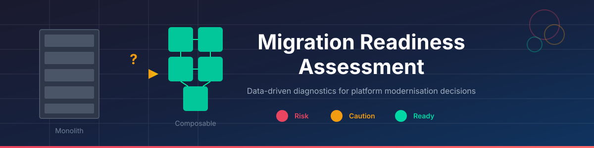

A diagnostic framework for engineering leaders and CTOs evaluating whether their organisation is ready for platform modernisation—and whether modernisation is even the right call.

## Overview

**Microservices are not a silver bullet.** A well-designed monolith can outperform a poorly executed distributed system any day. But when your monolith becomes the reason features take months instead of weeks, when deployments require all-hands-on-deck ceremonies, when your best engineers spend more time fighting the system than building value—that's when the conversation needs to happen.

This tool exists because migration failures are rarely technical. They're organisational. Teams misaligned on priorities. Leadership unaware of technical debt. Business stakeholders and engineers living in different realities. These gaps don't surface in architecture diagrams—they surface six months into a failed transformation when it's too late to course-correct.

**Run this assessment before you commit.** Surface the misalignments, quantify the risks, and make the investment decision with evidence instead of gut feel. Sometimes the answer is "not yet." Sometimes it's "never." That's valuable information too.

The tool:
- Collects structured feedback from stakeholder groups (Engineering, Product, Business, Leadership)
- Scores 6 readiness domains and 12 cross-cutting themes **from each group's own perspective**, then combines them so that every group counts equally, whatever its headcount
- Quantifies uncertainty with a stratified bootstrap and only asserts a status when the evidence supports it
- Checks whether each domain behaves as a coherent scale (Cronbach's α) and flags when it does not
- Tests where stakeholder groups genuinely disagree, and separates that from sampling noise
- Optionally codes free-text answers with an LLM through the [Vercel AI Gateway](https://vercel.com/docs/ai-gateway)
- Produces a client-ready **PDF report** (Typst, brandable) and a **validation notebook** that exposes every number behind it

> **Status — v2, phase 1.** This release fixes the calculation errors found in a statistical review of v1 (see [What changed in v2](#what-changed-in-v2)) and introduces the report pipeline. The questionnaire itself is unchanged and still measures *readiness to execute* a change rather than *whether* the change is warranted; the redesign is described in the [roadmap](#roadmap).

## Quick start

```bash
git clone https://github.com/kayoslab/Migration-Readiness-Assessment.git
cd Migration-Readiness-Assessment

uv venv && uv pip install -e '.[dev]'      # or: python -m venv .venv && pip install -e '.[dev]'
nbstripout --install                        # keeps notebook outputs out of git

mra report                                  # → Output/report.pdf
```

Requires Python ≥ 3.12. The PDF is compiled with the bundled Typst Python package; no separate Typst or LaTeX installation is needed.

| Command | What it does |
|---|---|
| `mra report` | v2 (legacy): analyse a v2 survey (`assessment.yaml`), write `Output/report.pdf`. For v3 engagements use `mra report <engagement.yaml>` |
| `mra report --llm` | Also code free-text answers via the Vercel AI Gateway |
| `mra check-llm` | One-line request to verify the gateway key and model |
| `python generate_sample_data.py` | Regenerate the synthetic sample data |
| `jupyter lab Validation.ipynb` | Inspect every intermediate result, sensitivity checks, v1 comparison |

## v3 decision engine (in development)

v3 recommends a **path per decision** instead of scoring readiness for a path chosen in advance — see
[`docs/phase-2-plan.md`](docs/phase-2-plan.md) and the instrument in [`instrument/`](instrument/README.md).
Milestones M1 (instrument and data layer), M2 (architecture decision), M3 (hosting decision with a 5-year TCO
model, `mra/tco.py`) and M4 (preferences, stakes, alignment and operating-model fit, `mra/stakes.py`) are
implemented, M5 calibrated it on 1,350 simulated engagements ([`docs/calibration.md`](docs/calibration.md)), and M6 added the v3 report and the [`Decision.ipynb`](Decision.ipynb) validation notebook. The pilot (M7) follows.

```bash
mra validate                         # cross-check the instrument files
mra decide path/to/engagement.yaml   # recommended path per decision, probability, preconditions, cost case, what would change it
mra report examples/techco/engagement.yaml   # one document: recommended paths, readiness by group, preconditions, people, next steps
mra report examples/techco/engagement.yaml --llm   # adds the free-text analysis and a checked executive narrative (Vercel AI Gateway)
mra init engagements/acme                    # blank engagement with annotated templates
mra coupling <repo> --modules modules.yaml   # scripted coupling facts from git history
mra forms engagements/acme/engagement.yaml --out forms.gs   # Google Apps Script that creates the survey forms
mra simulate [--quick]               # validity grid and threshold sweeps on synthetic engagements
```

An engagement folder holds `engagement.yaml`, one form export per stakeholder group, `facts.yaml` and (after the
verdict) `governance.yaml`; formats are documented in [`mra/engagement.py`](mra/engagement.py).
[`mra/scenario.py`](mra/scenario.py) builds synthetic engagements with a known correct outcome; the expert panel's
walk-through cases in [`tests/test_decision.py`](tests/test_decision.py) and [`tests/test_hosting.py`](tests/test_hosting.py)
run on every test run.

## Configuring an engagement (v2)

Everything engagement-specific lives in [`assessment.yaml`](assessment.yaml): organisation name and report metadata, response files per stakeholder group, answer labels, and the **decision rules**.

**Agree the decision rules with stakeholders before anyone sees results**, and record who signed them off (`decision_rules.signed_off_by`). This is what turns the assessment into a neutral referee rather than a tool that can be read to suit whichever side someone is on. The report shows the rules in its appendix and flags when sign-off was not recorded.

| Rule | Default | Meaning |
|---|---|---|
| `red_below` / `green_from` | 3.0 / 4.0 | Status thresholds for a domain index |
| `proceed_from` | 3.5 | Every domain must clear this for "Proceed" |
| `confidence` | 0.80 | Bootstrap probability required before a status or verdict is asserted |
| `role_weights` | equal | Weight of each stakeholder group in a domain index |
| `essential_roles` | all | Groups that must be represented for any verdict |
| `role_veto_domains` | Business Alignment, Culture | A strongly negative group here blocks "Proceed" |
| `min_role_n` / `min_role_items` | 5 / 3 | Minimum respondents and statements for a group's score to count |
| `strong_evidence_role_n` | 15 | Below this per essential group, findings are labelled *indicative* |

### Responses

One CSV per stakeholder group (as exported from Google Forms or similar), with the question text as column headers. Answers may be labels (`Agree`) or numbers (`4`). Blank cells are missing, never zero; `Don't know` is recorded separately. Statements are matched to [`Questions/export.csv`](Questions/export.csv) by text; each statement's role flags define who was asked it.

### Free-text analysis (optional)

```bash
cp .env.example .env        # then set AI_GATEWAY_API_KEY
mra check-llm
mra report --llm
```

Uses Vercel's [AI SDK for Python](https://vercel.com/docs/ai-gateway/sdks-and-apis/ai-sdk-python) (`ai`) through the AI Gateway. The default model is `anthropic/claude-opus-5.5`; set `llm.model` in `assessment.yaml` or `MRA_LLM_MODEL` to use any model the gateway offers (a smaller model such as `anthropic/claude-haiku-5.5` is plenty for coding).

Each respondent's answers are coded against a fixed codebook — sentiment, stance on the change, themes, motives — and validated against a schema. A final call writes the qualitative findings using only those codes and verbatim quotes. Groups are compared by share of their answers, not volume. E-mail addresses, phone numbers, URLs and any `llm.redact_terms` are removed before sending. Results are cached in `Output/llm_cache/`, so re-runs cost nothing.

### Branding the report

The report template lives in [`report/templates/default/`](report/templates/default/). To match an organisation's identity, copy the folder, edit the `theme` dictionary at the top of `template.typ` (colours, fonts, logo) and point `report.template` in `assessment.yaml` at the copy. Fonts placed in a `fonts/` folder next to the template are picked up automatically. `main.typ` holds the report structure and reads all content from the generated `Output/build/report.json`.

## Methodology

### Scoring

1. **Person score** — mean of a respondent's answers in a domain, if they answered ≥ 60% of the statements addressed to them.
2. **Group score** — mean of person scores within a stakeholder group (only that group's respondents).
3. **Domain index** — weighted mean of group scores; each group counts equally by default, so a large Engineering team cannot outvote four executives.
4. **Uncertainty** — respondents are resampled within each group (2,000 times); the report shows 95% ranges and the probability of each status.
5. **Status** — RED / AMBER / GREEN from the point estimate, marked *uncertain* when the bootstrap puts less than the agreed confidence on it.

### Verdict

| Verdict | Rule |
|---|---|
| **Insufficient evidence** | An essential group has fewer than `min_role_n` respondents |
| **Not ready** | Any domain is RED with ≥ `confidence` probability, or any essential group is RED on a veto domain |
| **Proceed** | Every domain clears `proceed_from` with ≥ `confidence` probability and no group scores any domain RED |
| **Proceed with conditions** | Otherwise; the report lists the conditions |

### Other analyses

- **Reliability** — Cronbach's α per group × domain (pairwise covariance, robust to scattered missing answers). Below 0.70 the statements do not behave as one scale.
- **Role differences** — Kruskal–Wallis across groups per domain, effect size ε², Benjamini–Hochberg adjusted.
- **Statement-level gaps** — permutation test on the largest difference between group means, FDR-adjusted; only groups meeting the minimum size are compared.

### What is deliberately *not* done

v1 reported several statistics that do not support a decision; v2 removes them: one-sample t-tests of every statement against "neutral", post-hoc power from observed effects, a "readiness %" (which scored an all-neutral organisation at 60%), "within-team variance" charts, hard-coded impact/feasibility weights, LDA topic models and VADER sentiment on a few dozen answers.

## What changed in v2

An independent statistical review re-ran the v1 notebook and found, among others:

| v1 issue | Effect | v2 |
|---|---|---|
| Group scores filtered statements by role but **not respondents** | Every group's score was in fact everyone's average; Cultural Readiness showed 3.4 for all four groups (actual range 2.8–3.8) | Respondents filtered by group |
| Missing answers stored as 0 | Inconsistent averaging across cells | Missing is missing |
| Three different RAG rule sets | Same data, different colours | One rule set, from `assessment.yaml` |
| Readiness % = mean/5 | Neutral everywhere = 60% = CONDITIONAL GO | Removed; verdict uses probabilities |
| Go/No-Go | All Business answering "strongly disagree" still gave CONDITIONAL GO | Any dissenting group now changes the verdict |
| Alignment gaps = max−min of means | ~40% of flagged gaps expected by chance | Permutation tests with FDR control |

The notebook's section 7 shows v1 and v2 group scores side by side.

## Roadmap

Expert reviews (organisational change, architecture, statistics) agreed that the questionnaire presupposes the migration: it can say "ready" or "not ready" but never "stay", "fix delivery practices first" or "modularise in place". Planned phases:

1. **Decision model** — separate *Need* (is there architectural pain?) from *Capability* (can we operate the target?), add pass/fail *Gates* (sponsor, funding incl. dual-running, protected capacity, stop criteria) and *Alignment & stakes* (stated preference and personal stake per respondent). Evaluate bundled decisions separately, e.g. architecture style vs. hosting (bare metal ↔ cloud). Outcomes include *stay and improve*, *modular monolith*, *targeted extraction*, *broad decomposition*, *consolidate*.
2. **Mindset & operating-model fit** — scenario-based items on domain ownership, decentralised decisions, tolerance for eventual consistency and product-vs-project funding, measured as fit to each outcome rather than a maturity grade.
3. **Instrument** — a technical fact sheet (DORA metrics, change coupling, shared-table ratio, run cost) alongside a shorter survey (~40 items per person, core items asked of every group, reverse-keyed items, "don't know").
4. **Validation** — scenario grid with known correct outcomes and misclassification rates.

## Project structure

```
├── assessment.yaml              # engagement configuration and decision rules
├── Questions/export.csv         # questionnaire (statements, domains, themes, role targeting)
├── Responses/*.csv              # one export per stakeholder group (sample data included)
├── mra/                         # analysis package
│   ├── data.py                  #   loading into long format
│   ├── scoring.py               #   scores, bootstrap, reliability, differences, verdict
│   ├── llm.py                   #   free-text coding via Vercel AI Gateway
│   ├── charts.py                #   report exhibits
│   ├── report.py                #   narrative + Typst compilation
│   └── cli.py                   #   `mra` command
├── report/templates/default/    # Typst template (template.typ = branding, main.typ = structure)
├── Validation.ipynb             # validation & exploration notebook
├── generate_sample_data.py      # synthetic "TechCo" scenario
└── tests/                       # regression tests incl. every v1 issue above
```

## Sample data

The included responses describe a fictional mid-size e-commerce company ("TechCo"): 18 engineers, 10 product managers, 8 business stakeholders and 6 leaders. Each simulated person has a consistent outlook, some agree with everything, ~8% of statements are skipped and free-text tone follows each person's scores. On this data the assessment returns **Not ready (indicative)**, driven by Integration & Data Readiness, with large perception differences between Leadership and Product on Business Alignment.

## Limitations

- Measures perceived readiness to execute, not whether the change is warranted (see roadmap).
- Survey answers are subject to social desirability and acquiescence, especially in small groups where anonymity is limited.
- With fewer than ~15 respondents per group, findings are indicative; below 5, a group is not scored.

## License

MIT

---

## Information for Participants

### What's this about?
Your organisation is exploring opportunities to evolve its technology platforms to better support speed, scalability, and alignment with business needs. This questionnaire helps identify strengths, gaps, and opportunities across teams and technologies.

### Who should take part?
- **Engineering**: Architecture, system maturity, team capabilities, technical bottlenecks
- **Product**: Delivery practices, team autonomy, business alignment
- **Business**: Strategy, integration readiness, platform value understanding
- **Leadership**: Sponsorship, organisational alignment, cultural support

### How it works
- Takes approximately 10-15 minutes
- Rate statements using a 1-5 scale (Strongly Disagree to Strongly Agree)
- Optional comments provide valuable context

### What happens next
Results are analysed to generate a report that:
- Summarises readiness across six domains
- Visualises alignment and gaps between roles
- Provides actionable recommendations

This is a diagnostic tool, not a performance review.
